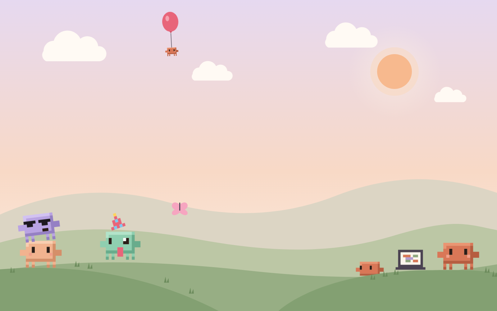
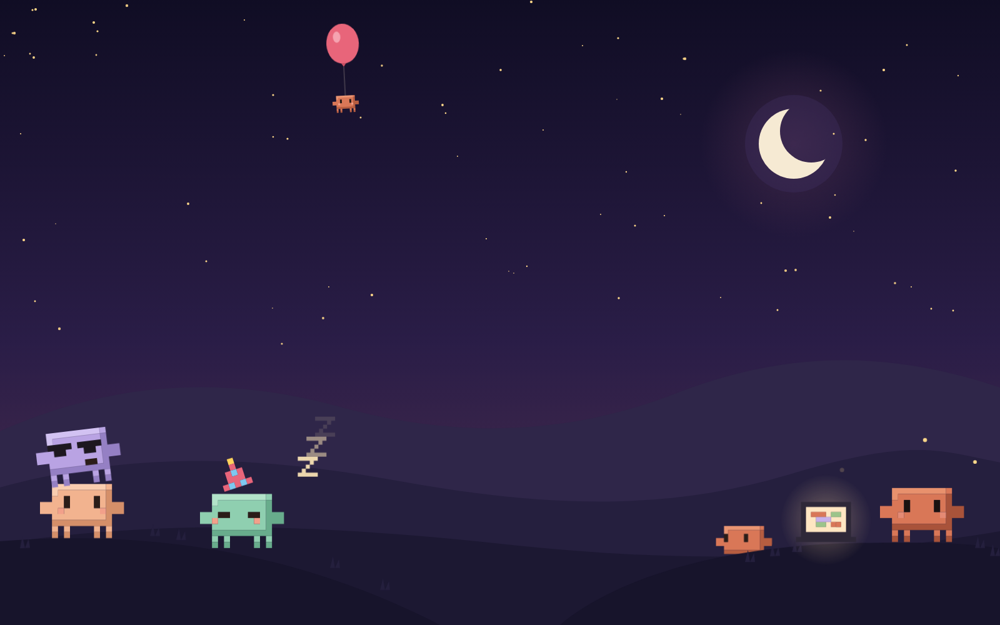

# claude-themes

My Claude themes, all in one place. Each theme is its own plugin in `themes/`, and this repo is the marketplace that lists them.

## Themes

| Theme | Look |
|---|---|
| **alif-skyline** | The look of [7ymera.github.io](https://7ymera.github.io): cobalt ink on pale blue paper by day, deep night-city navy by night, gold for warnings. A faint Kuala Lumpur skyline (Menara KL, Petronas Towers, Merdeka Maybank, The Exchange 106) and a ringed moon sit at the right edge behind the chat, clear of the text and the message box. |
| **alif-beach** | A beach. Warm sand paper and deep sea-teal ink by day, a moonlit shoreline by night, with a faint sun, drifting waves, a small boat and a palm at the right edge behind the chat. |
| **alif-kl-day** | Pixel-art Kuala Lumpur by day: a bright blue sky, pixel clouds and sun, a dense skyline (Menara KL, Petronas Twin Towers with their skybridge, Merdeka Maybank, The Exchange 106) and a grass strip along the bottom. Light mode only. |
| **alif-kl-night** | The same skyline at night: stars, a crescent moon and twinkling lit windows. Dark mode only. |
| **alif-pixel-meadow** | A soft meadow full of goofy pixel critters: one typing at a glowing laptop, a gopher that peeks out of the hill, a cool lilac critter in sunglasses wobbling on a friend’s head, a mint derp in a party hat with its tongue out (it falls asleep at night), and a tiny one floating by on a balloon. Peach morning and drifting clouds by day, plum starry night, moon and fireflies by dark. Light and dark. |




Themes draw in the Claude desktop and mobile apps. The terminal and editors draw no themes.

## Install

At the prompt of a terminal session:

```
/plugin install alif-skyline --marketplace 7YMERA/claude-themes
/plugin install alif-beach --marketplace 7YMERA/claude-themes
/plugin install alif-kl-day --marketplace 7YMERA/claude-themes
/plugin install alif-kl-night --marketplace 7YMERA/claude-themes
/plugin install alif-pixel-meadow --marketplace 7YMERA/claude-themes
```

Answer `y` to add the marketplace, then pick a scope. From a shell:

```
claude plugin install alif-skyline --marketplace 7YMERA/claude-themes
```

Install only one theme at a time to use: each sets the whole look, so with several enabled, the last to load wins.

## Add another theme

1. Copy `themes/alif-skyline` to `themes/<new-name>` and change `name` in its `.claude-plugin/plugin.json`.
2. Change the colours in `hooks/register.tsx`. The `makeColors` helper in `hooks/make-colors.js` builds the whole palette from a few anchor colours; leave that file as it is.
3. Add an entry for it to `.claude-plugin/marketplace.json`, with `"source": "./themes/<new-name>"`.
4. Run `claude plugin validate themes/<new-name>`.

## Check a theme

Look at it in both light and dark mode, with a long code block and at a larger text size. Automated checks cover contrast numbers but cannot paint.
